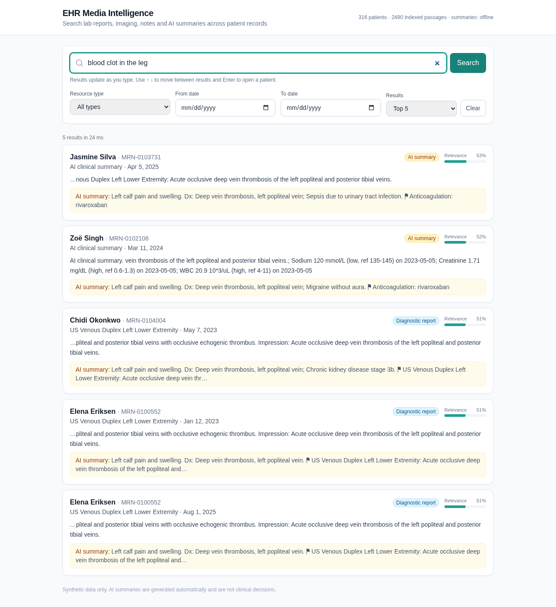
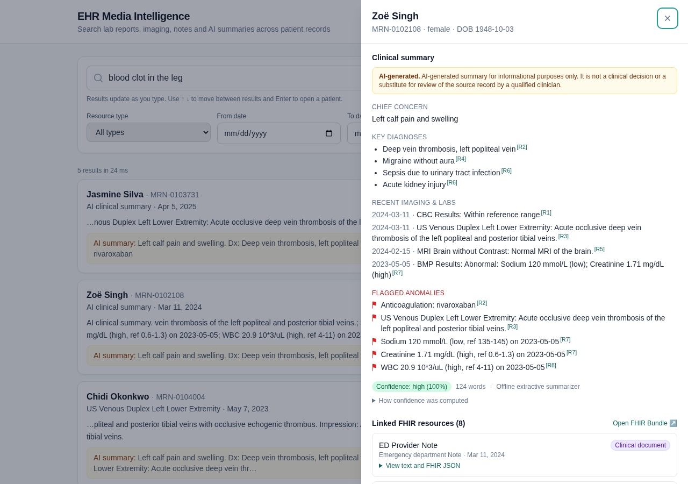
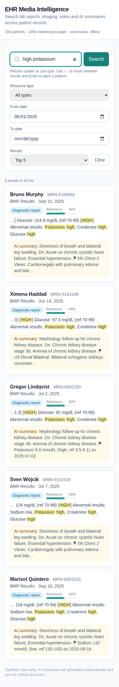

# EHR Media Intelligence Platform

Ingests messy, heterogeneous EHR exports, cleans them with a per-record audit trail, normalizes them to
**HL7 FHIR R4** Bundles, generates grounded **AI clinical summaries**, and serves a **semantic search** API with a
clinician-facing UI.

> All data in this repository is synthetic and generated by `scripts/generate_data.py`. No real patient data is used.



| Patient drawer | Mobile |
|---|---|
|  |  |

---

## Quick start

Requires Python 3.11+ (developed on 3.12).

```bash
python -m venv .venv && source .venv/bin/activate
pip install torch --index-url https://download.pytorch.org/whl/cpu   # CPU build, avoids the multi-GB CUDA wheel
pip install -r requirements.txt

python -m ehr.cli build     # generate data (first run) -> clean -> FHIR -> validate -> summarize -> index
python -m ehr.cli serve     # UI at http://127.0.0.1:8000, API docs at http://127.0.0.1:8000/docs
pytest                      # 132 tests, no network or API key needed
```

The first `build` generates 16 curated edge-case patients plus a 300-patient random cohort, and downloads the
all-MiniLM-L6-v2 model (about 90 MB). It takes about 2–3 minutes on a laptop CPU. Use `--patients N` to change the cohort size.

**Claude summaries.** Set `ANTHROPIC_API_KEY` (or log in with `ant auth login`) and run
`python -m ehr.cli build --force-summaries`. Without credentials, the pipeline uses a deterministic offline
summarizer, so everything still works.

| Env var | Default | Purpose |
|---|---|---|
| `EHR_SUMMARIZER` | `auto` | `auto` (Claude if credentials exist, else offline), `claude`, `offline` |
| `EHR_CLAUDE_MODEL` | `claude-opus-5-5` | Model used for summaries |
| `EHR_EMBEDDER` | `sentence-transformers` | `hash` = dependency-free embedder for offline/CI runs |
| `EHR_RAW_DIR`, `EHR_OUT_DIR`, `EHR_DB_PATH`, `EHR_CHROMA_DIR` | `data/...` | Storage locations |

---

## Architecture

```
data/raw/  (EHR JSON export, site-B JSON list, 2 lab CSV layouts, scanned .txt notes)
   │  loaders.py      format-specific parsing only (key aliases, header aliases, encodings)
   ▼
ingest/pipeline.py    normalize → resolve identities → dedupe → canonical Pydantic models + audit log   [Task 1]
   ▼
fhir/mapping.py       Patient · Encounter · DocumentReference · DiagnosticReport · Observation Bundles  [Task 2]
fhir/validation.py    structure (fhir.resources) + required bindings + reference integrity → report
fhir/store.py         SQLite: bundles, resource index, identifier index (official + merged MRNs)
   ▼
summarize/            context (citable R1..Rn) → Claude structured output | offline extractive         [Task 3]
                      → grounding/length checks → confidence → SQLite cache
   ▼
search/               chunk → MiniLM embeddings → Chroma; hybrid ranking + filters                      [Task 4]
   ▼
api.py + frontend/    FastAPI (POST /search, /patients/{id}, FHIR endpoints) + Tailwind/vanilla JS UI   [Task 5]
```

Outputs land in `data/output/`: `clean_dataset.json`, `audit_log.jsonl`, `validation_report.md/json`,
`bundles/*.json` and `summaries/*.json`.

---

## Design decisions by task

### 1. Ingestion and cleaning (`ehr/ingest/`)
- **Five input layouts:** an EHR JSON export, a second site's JSON list with different key names, the main lab CSV,
  a vendor lab CSV (semicolon-delimited, Latin-1, European decimals and dates, SI units), and scanned text notes
  with OCR noise.
- **Normalization:** MRNs become `MRN-#######`; ten date formats are parsed (two-digit birth years never land in
  the future; ambiguous `04/07` is read US-style and logged); gender maps to FHIR administrative-gender,
  including ISO 5218 numeric codes; names are parsed from "FAMILY, Given" or "Given Family", with Mc/O'
  capitalization, hyphens, accents and generational suffixes handled.
- **Labs:** a catalog of 21 analytes and 13 panels maps aliases (HGB/Hb/Hemoglobin) to LOINC codes, converts units
  (glucose mmol/L to mg/dL, creatinine µmol/L to mg/dL, hemoglobin g/L to g/dL, HbA1c mmol/mol to %), and parses
  messy values (`5,6`, `1,250`, `<0.01`, `H 5.6`, `pending`). Flags are re-derived from the reference range,
  critical flags (HH/LL) are preserved, and a source flag that contradicts the range is corrected and logged.
- **Identity resolution:** records are grouped by canonical MRN. Two MRNs with the same name and birth date are
  merged **only** when the second appears only in a secondary source and the difference looks like a keying error
  (an adjacent-digit transposition or at most two changed digits). Anything else is flagged as a possible
  duplicate rather than merged, because a wrong merge mixes two people's charts. Field conflicts are resolved by
  majority vote, with ties going to the EHR export, and day/month transpositions in birth dates are detected.
- **De-duplication:** documents are fingerprinted on patient, document family, day and text, ignoring whitespace
  and case. This catches re-sent messages, whitespace-only copies and scanned copies of EHR documents. Repeated lab
  rows are dropped, and an empty value is back-filled from a later row.
- **Audit:** every change is an `AuditEntry` on the record it affects (field, action, before/after, reason,
  source). Dataset-level events (merges, dedups, dropped rows) are kept alongside.

### 2. FHIR R4 (`ehr/fhir/`)
- `fhir.resources` 8.x is the Pydantic v2 line. It defaults to R5 and ships R4B, which is backward-compatible with
  R4 for every resource used here, so validation uses the R4B models and the output is plain R4 JSON.
- There is one `collection` Bundle per patient. Encounters are included so that `subject` **and** `encounter`
  references resolve, and every reference is a `urn:uuid:` matching an entry `fullUrl`. IDs are deterministic
  UUIDv5 values, so rebuilds are byte-identical, which keeps cache keys stable.
- Labs become DiagnosticReport (category `LAB`, LOINC panel code) plus one Observation per analyte, with
  `valueQuantity` in UCUM units, `comparator`, `interpretation` (H/L/HH/LL/A) and `dataAbsentReason` for missing
  values. Imaging becomes DiagnosticReport (category `RAD`) with the impression as `conclusion`. Notes become
  DocumentReference with a LOINC document type and a base64 text attachment.
- Validation has three layers: structure (fhir.resources), required value-set bindings (fhir.resources accepts
  `status: "bogus"`), and referential integrity (dangling references, wrong subject). Results go to
  `validation_report.md`. All 316 Bundles are valid; the warnings are scanned outside records with no encounter,
  which are flagged rather than linked to a made-up encounter.

### 3. AI summaries (`ehr/summarize/`)
- **Claude call:** structured outputs (`output_config.format` with a JSON schema) return chief concern, key
  diagnoses, recent imaging and labs, and flagged anomalies. **Every item cites record IDs** (R1, E2, …). Server-side
  refusal fallback is enabled. If a summary is over 200 words, the model is asked once to shorten it, and a
  deterministic trim is the last resort.
- **Quality checks on every summary:** cited IDs must exist; every number in an item must appear in the cited
  record; key terms must overlap with the cited text; and the 200-word limit is enforced. **Confidence comes from
  these checks**, not from the model's own estimate. A fixed disclaimer is attached to every summary.
- **Cache:** SQLite, keyed by `sha256(patient_id | record_hash | prompt_version | model)`. A re-run on unchanged
  data makes zero API calls, while any change to the records, prompt or model regenerates the summary.
- **Offline extractive summarizer:** it copies phrases straight from record sections, so it is grounded by
  construction. It keeps the demo and CI working without a key and provides a baseline.

### 4. Semantic search (`ehr/search/`)
- **Indexing:** about 120-word overlapping chunks, each prefixed with the record title, embedded with
  all-MiniLM-L6-v2 and stored in Chroma using cosine distance. AI summaries are indexed as `Patient` records.
- **Ranking:** `0.8 × cosine + 0.2 × keyword match`, deduplicated to one hit per resource. AI summaries are scaled
  by 0.9 so that primary records win ties. A small, auditable table maps everyday terms to clinical ones
  ("blood clot" to thrombus/DVT, "kidney stone" to calculus), because MiniLM misses those links.
- **Filters:** resource type (repeatable) and date range are query parameters on `POST /search`. Dates are stored
  as integers because Chroma only range-filters numbers, and undated records are excluded from date-filtered
  searches. MRN queries, including old merged MRNs, resolve through the identifier index; a bare number that isn't
  a known MRN (such as "2025") is treated as a normal search term.
- **Latency:** 30–90 ms per query over 2,126 records, with the model loaded once at startup. The <2 s target for
  50 records is covered by a test.

### 5. Frontend (`frontend/`)
Vanilla JS with Tailwind (CDN), served by FastAPI on the same origin. It provides:
- debounced as-you-type search;
- result cards with name/MRN, date, type badge, relevance bar (with semantic and keyword parts) and an AI summary snippet;
- a patient drawer with the full summary, clickable citations that jump to the source resource, a confidence
  explanation, the linked FHIR resources (with lazy-loaded raw JSON) and a Bundle download;
- resource type, date range and top-k filters;
- skeleton loading, empty, error and "MRN not found" states;
- accessibility: `role="search"`, labelled controls, an `aria-live` result count, ↑/↓/Home/End/Enter navigation
  across results, and a modal dialog with a focus trap, Escape to close and focus restore. The layout is responsive.

---

## API

| Method | Path | Description |
|---|---|---|
| `POST` | `/search?resource_type=&date_from=&date_to=` | Body `{"query": str, "top_k": 1-20}` → ranked hits with scores, snippet and summary snippet |
| `GET` | `/patients` | All patients |
| `GET` | `/patients/{id}` | Demographics, AI summary, citation map, linked resources, validation status |
| `GET` | `/patients/{id}/bundle` | The patient's FHIR Bundle |
| `GET` | `/resources/{id}` | Any FHIR resource returned by search |
| `GET` | `/health` | Counts, embedder and summarizer in use |

---

## Testing

```bash
pytest              # 132 tests: cleaning edge cases, lab catalog, FHIR mapping/validation, summaries, search, API, UI
pytest -m slow      # also runs the real MiniLM model: semantic quality on lay queries + latency
```
Tests generate their own datasets (16 curated patients, plus a 60-patient cohort for the scale test), use a fake
Claude client and a hash embedder, and need no network access.

## Project layout
```
ehr/ingest/     models, normalizers, lab catalog, loaders, pipeline
ehr/fhir/       mapping, validation, store, text extraction
ehr/summarize/  schema, context, prompt, Claude + offline summarizers, quality checks, cache, service
ehr/search/     embedders, synonym expansion, Chroma index
ehr/api.py      FastAPI app        ehr/cli.py   build / ingest / serve
frontend/       index.html, app.js
scripts/        generate_data.py (synthetic data)
tests/          pytest suite
docs/           write-up and screenshots
```

See [docs/writeup.pdf](docs/writeup.pdf) for tradeoffs, planned improvements, the FHIR and clinical concepts I researched, and how summary quality was validated.
